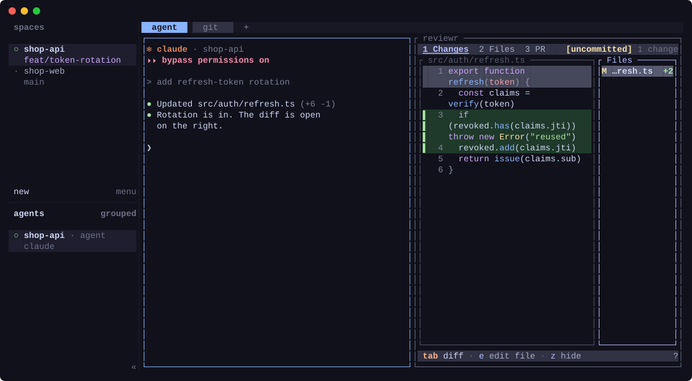

# herdr-respawn

[English](README.md) | [한국어](README.ko.md) | [日本語](README.ja.md) | 繁體中文



讓你在 [Herdr](https://herdr.dev) 伺服器重新啟動或電腦重新開機後，從上次中斷的地方繼續工作。

Herdr 會自行還原工作區、分頁、窗格和 cwd，也會重新開啟支援的代理程式，但不會帶上當初的啟動參數。其他窗格則全都變回空白的 shell。respawn 會在伺服器一恢復就把原本在這些窗格中執行的東西帶回來，不需要按任何鍵：

- 你開著的 **TUI**：lazygit、vim、htop、yazi 以及[允許清單](#允許清單)中的其他程式
- **外掛窗格**，例如開在代理程式旁邊的 [reviewr](https://github.com/persiyanov/herdr-reviewr) diff
- **Claude Code 的 agent view**（`claude agents`）
- 只要加一行設定，**代理程式會保留啟動參數**：以 `claude --dangerously-skip-permissions` 開啟的工作階段回來後仍會略過權限確認（[詳細說明](#代理程式保留啟動參數)）

前三項不需要任何設定。安裝後就會立刻開始儲存。

## 安裝

```sh
herdr plugin install devicki/herdr-respawn --ref v0.7.5
```

`--ref` 會固定在某個版本。省略的話則會追蹤 `main`。所有版本都列在 [tags](https://github.com/devicki/herdr-respawn/tags)。

請在每個執行 Herdr 伺服器的帳號中都安裝。每個伺服器以及每個具名工作階段都會各自保存快照。外掛儲存過一次之後，下次重新啟動時才會第一次還原；而只要你移動焦點，外掛就會立刻儲存。

**相容性**：Linux 與 macOS。需要 `bash`（macOS 預設的 3.2 就夠了）和 `jq` 1.6 或更新版本（macOS 上可用 `brew install jq`）。不支援 Windows；請在 WSL 中執行 Herdr。

## 運作方式

- **儲存**：每當發生 `pane.focused`、`tab.focused`、`workspace.focused`、`pane.closed` 和 `pane.agent_status_changed` 事件時，若各窗格的前景命令（argv）在允許清單中，就會把該命令和 cwd 寫入外掛的狀態目錄。代理程式會連同工作階段 id 一起儲存（[詳細說明](#代理程式保留啟動參數)），外掛窗格則以其所屬外掛儲存（[詳細說明](#外掛窗格)）。若要隨時手動儲存，請執行 `respawn: save now` 動作。
- **還原**：Herdr 還原工作階段後，會執行啟動 hook。它會用 `herdr pane run` 把每個儲存的命令重新輸入到原本的窗格，背景的分頁和工作區也一樣，但只限於該窗格已回到空白的 shell 提示字元時：也就是前景只有一個互動式 shell。仍在啟動中的 shell（rc 檔、fish 設定、提示字元工具）有 15 秒可以就緒；仍在忙的窗格會在背景每 2 秒再檢查一次，最多再等 2 分鐘（pyenv rehash 等待鎖定檔時，shell 可能停住約 1 分鐘）；超過時間後仍在執行某些東西的窗格（腳本、`sh -c` 工作、進行中的 handoff）則不會被動到。
  - 命令前面會加上一個空格，讓它不會留在 shell 歷史紀錄中（fish 預設如此，bash 需設定 `HISTCONTROL=ignorespace`/`ignoreboth`，zsh 需設定 `setopt HIST_IGNORE_SPACE`）。
  - 若窗格的 shell 不在儲存的目錄中，命令前面會加上 `cd <dir> &&`。如果該目錄已不存在，命令就不會執行。
  - 重新開機後已不存在的絕對程式路徑（或位於暫存目錄、`/nix/store` 底下的路徑）會換成程式名稱，讓 shell 透過 `PATH` 找到它。
- **關機**：在電腦關機過程中仍保持連線的用戶端（例如從筆電連進來的 SSH 工作階段）可能會在關機途中重新啟動 Herdr。那個伺服器接著會看到每個窗格都被結束：它會把每個窗格都記錄為已關閉，清空工作區，而儲存動作也會記錄下這些正在結束的窗格。因此在 systemd 環境中，從 logind 宣告關機的那一刻起（也就是 Herdr 自己用來儲存的同一個訊號，最多在 systemd 開始停止任何東西的 30 秒前），respawn 就不再儲存，並在這種伺服器一啟動時就將它停止，這樣會儲存它剛載入的版面配置；快照則留待開機後的啟動使用。
- 損毀的快照會被移到 `<file>.bad`，並重新開始儲存。之後被刪除的具名工作階段，其快照會在啟動時移除。

### 還原通知

respawn 會發出一則 toast 通知，例如 `respawn: 4 pane(s) restored`，並列出恢復了哪些東西。Herdr 的 toast 通知預設是關閉的，而且只會顯示給伺服器啟動時已連線的用戶端。若要看到通知：

```toml
[ui.toast]
delivery = "herdr"      # 若要桌面通知，請用 "terminal" 或 "system"
```

若已安裝並啟用 [herdr-pager](https://github.com/devicki/herdr-pager)，無論是否有用戶端連線，你的手機也會收到通知：

```
🔄 [work] Herdr 已重新啟動 · respawn 已還原 4 個窗格
claude x2, lazygit, persiyanov.reviewr
```

通知會依照 herdr-pager 自己的設定和語言發送（在 `pager.conf` 中設定 `lang = ko`、`ja` 或 `zh-TW`，分別對應韓文、日文或繁體中文），若是具名工作階段，也會附上工作階段名稱。不需要任何設定，沒有 herdr-pager 時一切照舊。

## 允許清單

由於重新執行任意命令（`git push`、資料庫遷移）並不安全，只有以下命令會被重新啟動：

```
lazygit lazydocker tig gitui vim nvim vi hx micro nano emacs htop btop top yazi ranger lf nnn k9s
```

可在 `$(herdr plugin config-dir devicki.respawn)/allowlist` 自訂清單，例如 `~/.config/herdr/plugins/config/devicki.respawn/allowlist`。外掛第一次執行時會建立這個檔案，內含內建清單，並以註解說明語法。每行寫一個名稱：單純的名稱會新增命令，`!name` 則會移除命令。比對的是 shell 在窗格中啟動的命令的檔名（basename），而不是它衍生的程序，所以 lazygit 自己執行的 `git log` 永遠不會取代 lazygit。

```
# 總是想帶回來的開發伺服器
npm
# 永遠不要重新啟動 top
!top
```

## 代理程式保留啟動參數

Herdr 會自行重新開啟 Claude Code、Codex、Devin 等代理程式，但一律以單純的 `claude --resume <id>` 開啟，所以當初啟動時的參數會遺失。以 `claude --dangerously-skip-permissions`（例如透過 `claude-yolo` alias）開啟的工作階段，回來後會再次要求權限確認：Claude Code 刻意不會在 resume 時還原 bypass 模式。

若要保留參數，請在 `config.toml` 中關閉 Herdr 自己的代理程式恢復功能：

```toml
[session]
resume_agents_on_restore = false
```

之後 respawn 就會自己恢復 Claude Code、Codex 和 Devin，使用 Herdr 記錄的工作階段 id 以及以下啟動參數：

| 代理程式 | 恢復方式 | 保留的參數 |
| --- | --- | --- |
| Claude Code | `claude <flags> --resume <id>` | `--dangerously-skip-permissions`, `--allow-dangerously-skip-permissions`, `--permission-mode`, `--model` |
| Codex | `codex resume <flags> <id>` | `--dangerously-bypass-approvals-and-sandbox`, `-s`/`--sandbox`, `-a`/`--ask-for-approval`, `-m`/`--model` |
| Devin | `devin <flags> --resume <id>` | `--permission-mode`, `--model` |

其他參數和任何提示詞都會被捨棄。Herdr 的代理程式恢復功能開啟時（預設值），respawn 不會動到代理程式，因為兩者會同時輸入到同一個窗格。

- 關閉後，這三種以外的代理程式會回來變成空白的 shell。如果你有使用它們，請保持開啟。
- 代理程式會一次啟動一個，間隔 100 ms，與 Herdr 自己的恢復方式相同。每個代理程式都會啟動自己的執行環境和 MCP 伺服器，而且 Claude Code 工作階段會共用設定檔，所以同時啟動太多會造成負載尖峰。工作階段很多時，請用 Herdr 自己的設定加大間隔，respawn 也會遵循：

  ```toml
  [session]
  startup_per_agent_delay_ms = 1000
  ```

  TUI 和外掛窗格會立即啟動。
- 從 Herdr 0.9.2 起，代理程式可以自行回報包含參數在內的恢復命令。這類代理程式在 Herdr 的恢復功能開啟時也會保留啟動參數，不需要 respawn 做任何事。
- 代理程式必須以自己的名稱（`claude`、`codex`、`devin`）執行；透過 `npx` 等包裝程式啟動的無法辨識。
- Claude Code 的 agent view（`claude agents`）用來管理背景工作階段，本身沒有工作階段，所以會完全依照當初的啟動方式（包含參數）重新執行。這在 Herdr 的代理程式恢復功能開啟時也有效。

## 外掛窗格

Herdr 也會把外掛窗格（例如開在代理程式旁的 [reviewr](https://github.com/persiyanov/herdr-reviewr) diff，或 memex 側邊欄）變回空白的 shell。respawn 會根據命令位於外掛目錄中來辨識這些窗格，並以 Herdr 提供給外掛窗格的環境，重新啟動該外掛目前對應此窗格的命令，所以結束它時也會像以前一樣關閉窗格。

- 進入點（entrypoint）的命令必須是外掛目錄中的程式或腳本（直接執行，或透過 `bash script.sh` 這類直譯器執行）。停留在包裝程式中的命令，例如沒有 `exec` 的 `sh -c '...'`，無法辨識。
- 會使用開啟該窗格時的窗格進入點。若一個外掛有多個命令相同的進入點（memex 的 desk、palette 和 sidebar），則從程序環境中讀取。
- 之後已停用或解除安裝的外掛會被略過。
- 允許清單不適用於外掛窗格。

## 檢查已儲存的內容

快照是外掛狀態目錄中的 JSON 檔，每個伺服器或具名工作階段各一個：

```sh
herdr plugin action invoke devicki.respawn.save; sleep 1
jq -r '.panes[] | "\(.pane) \(.plugin // .agent // "-") \(.entrypoint // (.argv | join(" ")))"' \
  ~/.local/state/herdr/plugins/devicki.respawn/*.json
```

```
w1:p1 claude claude --dangerously-skip-permissions --resume 3f2c9a
w1:p2 persiyanov.reviewr pane
w1:p3 - lazygit
```

`herdr plugin log list --plugin devicki.respawn` 會顯示每次儲存和還原的執行紀錄，包括上次還原帶回了什麼。

## 限制

- 環境變數不會被還原（virtualenv、由 alias 設定的 `NVIM_APPNAME` 等）。
- 在目前焦點窗格中啟動的命令，會在下次焦點切換或代理程式狀態變化時儲存。如果電腦可能在那之前就關機，請執行 `respawn: save now`，或將它綁定到按鍵：

  ```toml
  [[keys.command]]
  key = "prefix+shift+s"
  type = "plugin_action"
  command = "devicki.respawn.save"
  ```

- 快照會儲存完整的 argv。請勿在允許清單中程式的命令列參數裡放入機密資訊。

## 提示

若也想還原每個窗格最近的畫面輸出，請在 `config.toml` 中開啟 Herdr 自己的歷史重播功能。由於它會把窗格輸出寫入磁碟，預設是關閉的：

```toml
[experimental]
pane_history = true
```

## 更新與解除安裝

Herdr 沒有更新命令；請以新的 tag 重新安裝。允許清單、已儲存的快照和啟用狀態在重新安裝後都會保留，`herdr plugin list` 會顯示已安裝的版本。

```sh
herdr plugin install devicki/herdr-respawn --ref v0.7.5 --yes
herdr plugin uninstall devicki.respawn
```

解除安裝後，允許清單會留在 `~/.config/herdr/plugins/config/devicki.respawn`，快照會留在 `~/.local/state/herdr/plugins/devicki.respawn`；如果不打算重新安裝，請將它們刪除。

## 開發

```sh
herdr plugin link .
./test.sh   # 由其用戶端啟動的隔離 Herdr；送出類似重新開機的 SIGTERM；預期會重新啟動
```

`test.sh` 會在焦點窗格、背景分頁和背景工作區中執行 TUI，旁邊還有一個不在允許清單中的命令、一個必須帶著參數回來的替身 `claude --dangerously-skip-permissions`、Claude 的 agent view，以及一個在共用同一命令的兩個進入點中以第二個開啟的替身外掛窗格；並檢查兩個代理程式的啟動間隔為 `startup_per_agent_delay_ms`，以及替身 herdr-pager 有收到還原通知；接著模擬關機，檢查在關機期間啟動的伺服器會立即被停止，且快照未被更動。它需要 `tmux`、`jq`、`htop`、`vim`、`python3` 和 procps（`top`、`pgrep`），只能在 Linux 上執行（它透過 `/proc` 尋找自己的伺服器），而且絕不會動到你自己的 Herdr 工作階段。

`docs/demo/record.sh` 會在隔離的 Herdr 中，用一個虛構的專案重新錄製 `docs/demo.svg`（需要 `tmux`、`lazygit`，以及下載 reviewr 所需的網路連線）。

若要發布新版本，請調升 `herdr-plugin.toml` 中的 `version`，更新所有 README 中的 `--ref`，提交後執行 `git tag -a vX.Y.Z -m vX.Y.Z && git push origin vX.Y.Z`。

## 授權

MIT
